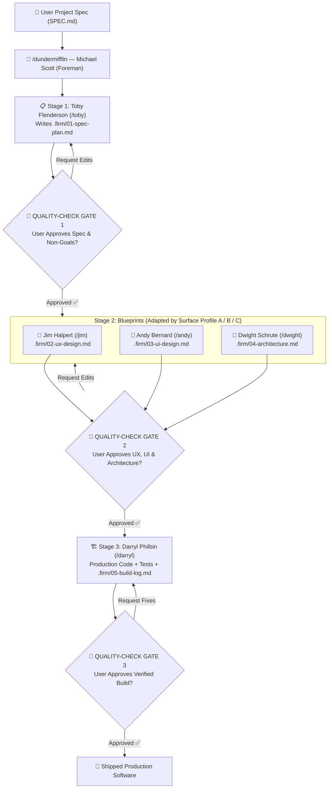

<div align="center">


<br />

#  Dunder Mifflin (`dundermifflin`)
### **Spec-Driven Multi-Agent Software Construction Firm for Google Antigravity**

[-0f172a?style=for-the-badge&logo=github&logoColor=38bdf8)](https://github.com/intmatt-0)
[](#)
[-1e1b4b?style=for-the-badge&labelColor=09090b&color=6366f1)](#how-it-works-the-sdd-pipeline)
[](#live-8-bit-visual-task-progress-board)

<p align="center">
  <a href="#what-is-dunder-mifflin">What It Is</a> •
  <a href="#purpose--the-problem-it-solves">Why It Exists</a> •
  <a href="#meet-the-scranton-branch-crew">The Crew</a> •
  <a href="#how-it-works-the-sdd-pipeline">How It Works</a> •
  <a href="#live-8-bit-visual-task-progress-board">Visual Progress Board</a> •
  <a href="#the-5-iron-anti-slop-laws">5 Anti-Slop Laws</a> •
  <a href="#quick-start--installation">Installation</a>
</p>

</div>

---

## What Is Dunder Mifflin?

**Dunder Mifflin (`dundermifflin`)** is a globally available **Spec-Driven Development (SDD)** multi-agent plugin for **Google Antigravity**, modeled after the characters of *The Office*.

Instead of letting a single AI prompt read your `SPEC.md` and monolithically dump an entire project in one unreviewed pass, **Dunder Mifflin** turns your AI environment into a **role-isolated software construction firm**:
- **Michael Scott (`/dundermifflin`)** acts as your **Regional Manager & Foreman**, reading your project specification Markdown file and dispatching 5 specialized subagents in strict sequence.
- **Toby, Jim, Andy, Dwight, and Darryl** each own a dedicated engineering discipline and a strict `.firm/01`–`05` blueprint contract—with **zero role bleed**.
- Every stage pauses at a mandatory **User Quality-Check Gate** and updates a live, animated **8-bit Pixel-Art Visual Task Progress Board** (`dundermifflin-board.html`) right in your IDE sidebar and chat.

---

## Purpose & The Problem It Solves

| The Problem with Monolithic "One-Shot" AI Coding | The Dunder Mifflin SDD Firm Solution |
| :--- | :--- |
| **Role Bleed & Context Collapse**: One agent tries to plan requirements, invent UX flows, pick colors, design schemas, and write code simultaneously. | **Strict Domain Isolation**: Each subagent only edits its own `.firm/` blueprint and domain files. Toby cannot write code; Darryl cannot invent unapproved UI or database schemas. |
| **Unrequested Feature Bloat**: Vague specs get padded with unrequested auth systems, extra settings pages, and premature abstractions. | **Toby's Non-Goals Ledger & Dwight's YAGNI Law**: Unrequested features are explicitly cut in Stage 1 (`01-spec-plan.md`) and banned in Stage 2 (`04-architecture.md`). |
| **"Happy-Path Only" UX & Generic AI Slop UI**: Missing loading/empty/error states and templated indigo/purple gradients. | **Jim's 4-State Matrix & Andy's Anti-Slop Tokens**: Every view must define `Ideal`, `Loading`, `Empty`, and `Error` states plus WCAG-verified semantic tokens before a single line of code is written. |
| **Zero Human Checkpoints Until It's Too Late**: You only see the result after thousands of lines of wrong assumptions are generated. | **3 Mandatory User Quality-Check Gates**: The firm pauses after **Spec Planning (Gate 1)**, **UX/UI/Architecture (Gate 2)**, and **Verified Build (Gate 3)** for your explicit sign-off. |

---

## Meet the Scranton Branch Crew

You can summon the entire company at once with **`/dundermifflin`**, or call any specialist 1-on-1 using their dedicated **`/character`** slash command when you want **only that specialist** to work on their part of the project:

| Sprite | Slash Skill | Character & Subagent ID | Role | What They Own & Edit | Strictly Forbidden From |
| :---: | :--- | :--- | :--- | :--- | :--- |
|  | **`/dundermifflin`** | **Michael Scott**<br/>*(Foreman)* | **Regional Manager & Orchestrator** | Reads `SPEC.md`, routes Surface Profile (`A`/`B`/`C`), dispatches crew, runs Quality-Check Gates 1–3, updates `dundermifflin-board.html` | Writing production application code or bypassing user Quality-Check Gates |
|  | **`/toby`** | **Toby Flenderson**<br/>*(`toby`)* | **Planner & Spec Definer** | `.firm/01-spec-plan.md` — Problem statement, Surface Profile lock, explicit **Non-Goals (Cut List)**, testable `Given/When/Then` criteria | Designing UI/UX, choosing database schemas, or editing source code |
|  | **`/jim`** | **Jim Halpert**<br/>*(`jim`)* | **UX Designer** | `.firm/02-ux-design.md` + UX flow/state behavior — Information architecture, step-by-step user flows, **Mandatory 4-State Matrix**, keyboard/CLI ergonomics | Choosing colors/fonts, designing backend schemas, or editing unrelated backend logic |
|  | **`/andy`** | **Andy Bernard**<br/>*(`andy`)* | **UI Designer** | `.firm/03-ui-design.md` + CSS/theme/token files — Aesthetic direction, modular type scale, WCAG contrast-verified color tokens, component visual states | Altering backend logic, database schemas, or core routing architecture |
|  | **`/dwight`** | **Dwight Schrute**<br/>*(`dwight`)* | **Software Architect** | `.firm/04-architecture.md` + schema/contract/config files — Locked file tree, strict data models, typed API contracts, **Ponytail/YAGNI minimalism** | Inventing visual aesthetics or writing feature implementation code |
|  | **`/darryl`** | **Darryl Philbin**<br/>*(`darryl`)* | **Warehouse Lead & Principal Engineer** | Production source code, tests & `.firm/05-build-log.md` — Builds strictly from `.firm/01`–`04` with zero `TODO` stubs and live command verification | Inventing unapproved features, changing locked schemas, or improvising UI styles |

---

## How It Works: The SDD Pipeline

### 1. Adaptive Surface Profile Router (`FRAMEWORK.md`)
Not every project has a graphical UI. Before dispatching specialists, **Michael** and **Toby** classify your `SPEC.md` into one of three **Surface Profiles** so you never waste tokens on unnecessary design docs:

- **Profile A — Full-Stack / Frontend / Mobile / Desktop UI**: Runs all 5 specialists (`Toby → Jim + Andy + Dwight → Darryl`).
- **Profile B — CLI / TUI / Developer Tool**: Runs `Toby → Jim (CLI ergonomics & flags) + Dwight → Darryl` *(skips Andy's visual UI layer)*.
- **Profile C — Headless API / Backend Worker / SDK Library**: Runs `Toby → Dwight → Darryl` *(skips both Jim and Andy)*.

### 2. Baton-Pass Workflow & Quality-Check Gates



---

## Live 8-Bit Visual Task Progress Board

Whenever you run `/dundermifflin` (or any individual `/toby`, `/jim`, `/andy`, `/dwight`, `/darryl` command), the firm automatically creates and updates `dundermifflin-board.html` in your conversation's **Artifacts** tab and renders it inline:

<div align="center">
  
</div>

### Board Highlights
- **Custom Embedded 5x7 Pixel Font (`DunderPixel.ttf`)**: Base64-embedded directly into the HTML so it works 100% offline inside sandboxed iframes with zero external CDN requests.
- **Character-Accurate 8-Bit Sprite Animations (`steps(1, end)`)**:
  - **Michael** bobs, blinks, and sips his *"World's Best Boss"* mug with rising steam pixels.
  - **Toby** does a slow HR sigh with a pulsing sweat-drop pixel.
  - **Jim** does his signature *"Look at the Camera"* eyebrow raise and smirk.
  - **Andy** bounces in double-time with floating musical note pixels.
  - **Dwight** nods on patrol with a yellow-white glint sweeping across his glasses.
  - **Darryl** grooves with a pulsing status indicator on his warehouse uniform.
- **Interactive Stage Filters & Smooth Accordion Drawers**: Filter by `All Branch Staff`, `Stage 1: Spec`, `Stage 2: UX / UI / Arch`, or `Stage 3: Build`, and click any card to expand/collapse its live checklist.

---

## The 5 Iron Anti-Slop Laws

Every agent in Dunder Mifflin is bound by the **5 Iron Laws** in [`FRAMEWORK.md`](FRAMEWORK.md):

1. **Law 1 — Anti-Bloat & Scope Lock (Toby)**: Every feature must trace to the user's `SPEC.md`. Unrequested bells and whistles go straight into the **Non-Goals (Cut List)**.
2. **Law 2 — Complete 4-State Coverage (Jim)**: Every user-facing view or CLI command must explicitly specify `Ideal`, `Loading`, `Empty`, and `Error` states before implementation.
3. **Law 3 — Intentional Visuals & Zero Generic AI Slop (Andy)**: Bans default purple/indigo gradients, glow-blob backgrounds, unrequested 3-column icon grids, and low-contrast text. Enforces semantic tokens and WCAG AA/AAA contrast ratios.
4. **Law 4 — Ponytail / YAGNI Minimalism (Dwight)**: The best code is the code never written. Zero speculative abstractions, zero wrapper classes for one-time operations, and zero new dependencies for a few lines of standard-library logic.
5. **Law 5 — Zero Role Bleed & Zero Stubs (Darryl)**: Darryl implements strictly from `.firm/01`–`04` with zero `TODO`s, zero placeholder functions, and mandatory live terminal verification logged in `.firm/05-build-log.md`.

---

## Quick Start & Installation

### 1. Install the Plugin
Clone this repository and run the 1-command PowerShell installer (which copies the bundle to `~/.gemini/config/plugins/dundermifflin` and configures paths automatically for your machine):

```powershell
git clone https://github.com/intmatt-0/dundermifflin.git
cd dundermifflin
powershell -ExecutionPolicy Bypass -File ./install.ps1
```

*(Or clone directly into your Antigravity plugins folder:)*
```bash
git clone https://github.com/intmatt-0/dundermifflin.git ~/.gemini/config/plugins/dundermifflin
```

### 2. Summon the Firm in Any Conversation
- **Build a full project from a spec file**:
  ```text
  /dundermifflin Build my project from ./SPEC.md
  ```
- **Call a single specialist to edit only their domain**:
  ```text
  /toby Tighten the acceptance criteria and cut out OAuth from .firm/01-spec-plan.md
  /jim Add keyboard shortcuts to the modal flow in .firm/02-ux-design.md
  /andy Switch the palette in .firm/03-ui-design.md and globals.css to a warm brutalist editorial theme
  /dwight Simplify the SQLite schema in .firm/04-architecture.md to 2 tables
  /darryl Implement Milestone 2 from .firm/04-architecture.md and run the test suite
  ```

---

## Repository Structure

```text
dundermifflin/
├── plugin.json                        # Antigravity plugin manifest
├── FRAMEWORK.md                       # Adaptive Surface Profile router & 5 Iron Anti-Slop Laws
├── install.ps1                        # Cross-machine 1-command installer script
├── README.md                          # Documentation & visual showcase
├── agents/                            # Pre-registered specialist subagents
│   ├── toby.md                        # Toby Flenderson — Planner & Spec Definer
│   ├── jim.md                         # Jim Halpert — UX Designer
│   ├── andy.md                        # Andy Bernard — UI Designer
│   ├── dwight.md                      # Dwight Schrute — Software Architect
│   └── darryl.md                      # Darryl Philbin — Principal Software Engineer
├── assets/                            # Animated 16x16 pixel-art SVG sprites & README visuals
│   ├── banner.svg                     # 8-bit Scranton Branch Hero Banner
│   ├── board-preview.svg              # Visual Task Progress Board SVG preview
│   ├── logo.svg                       # Dunder Mifflin plugin icon
│   ├── michael.svg                    # Michael Scott animated pixel sprite
│   ├── toby.svg                       # Toby Flenderson animated pixel sprite
│   ├── jim.svg                        # Jim Halpert animated pixel sprite
│   ├── andy.svg                       # Andy Bernard animated pixel sprite
│   ├── dwight.svg                     # Dwight Schrute animated pixel sprite
│   └── darryl.svg                     # Darryl Philbin animated pixel sprite
├── skills/                            # Global slash skills (/dundermifflin, /toby, /jim, /andy, /dwight, /darryl)
│   ├── dundermifflin/SKILL.md         # Michael Scott Foreman orchestrator skill
│   ├── toby/SKILL.md                  # Direct /toby specialist skill
│   ├── jim/SKILL.md                   # Direct /jim specialist skill
│   ├── andy/SKILL.md                  # Direct /andy specialist skill
│   ├── dwight/SKILL.md                # Direct /dwight specialist skill
│   └── darryl/SKILL.md                # Direct /darryl specialist skill
├── templates/
│   └── dundermifflin-board.html       # Self-contained animated pixel-font Visual Task Progress Board
├── docs/
│   ├── dev-firm-design.md             # System architecture & design specification
│   └── dev-firm-plan.md               # Implementation plan
└── scripts/
    ├── test-dundermifflin.ps1         # Automated 22-file contract verification suite
    └── make_pixel_font.py             # Embedded 5x7 TrueType pixel font (DunderPixel.ttf) generator
```

---

## Created By

Designed, conceptualized, and created by **Karl Matthew** ([`@intmatt-0`](https://github.com/intmatt-0)) — built to turn chaotic one-shot AI prompting into a disciplined, human-gated, Spec-Driven software construction firm.
